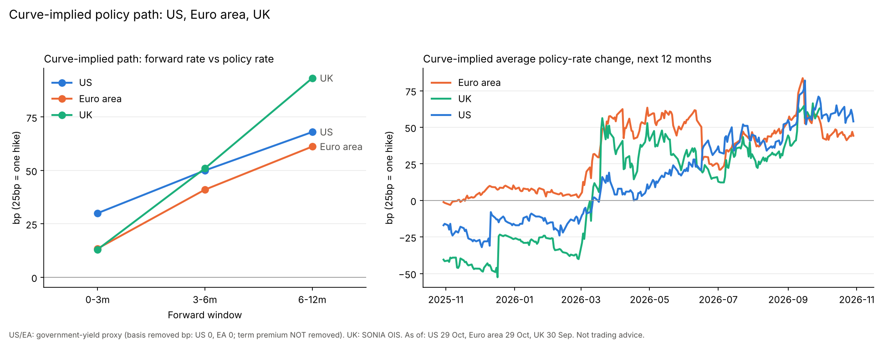

# rates-pricing-tracker

Tracks how much tightening or easing the interest-rate curves imply for the **US**, **euro area** and **UK**, using free public data only (no API keys). A scheduled GitHub Action refreshes the chart and data every weekday.



> **What this is, and is not.** This is a *curve-implied proxy*, not market pricing in the futures/OIS sense. The US and euro-area curves are government yields, which carry term premium and a basis to the policy rate that this tracker does not fully remove. Only the UK curve is genuine OIS. For true meeting-by-meeting pricing, see `futures_pricing.py` below. Not trading advice.

## Data sources

| Region | Policy rate | Curve |
|---|---|---|
| US | Effective Fed Funds Rate (NY Fed) | US Treasury 3m, 6m, 1y, 2y yields |
| Euro area | Euro short-term rate (ECB) | ECB AAA government spot curve |
| UK | Bank Rate (Bank of England) | Bank of England SONIA OIS spot curve |

The Bank of England file is only updated monthly, so the UK line lags the others. The BoE site rejects Python's `requests` client, so those two requests are made with the system `curl`.

## What the two charts show

### Left: the curve-implied path right now

One snapshot at the latest date. Each point is the forward rate in a future window minus today's policy rate, in basis points (25bp = one hike).

A yield is an average rate from today to that maturity. To isolate a later window, take the longer yield, remove the shorter one, and divide by the window length:

`forward = (y_long × t_long − y_short × t_short) / (t_long − t_short)`

Worked US example (29 Oct 2026), EFFR 3.88%, yields 3m 4.18, 6m 4.28, 1y 4.42, 2y 4.61:

| Window | Forward rate | Minus EFFR |
|---|---|---|
| 0–3m | 4.18% | +30bp |
| 3–6m | 4.38% | +50bp |
| 6–12m | 4.56% | +68bp |
| 12–24m (hidden by default) | 4.80% | +92bp |

Each point is the *level* of the implied rate in that window, not the number of hikes inside it.

### Right: the 12-month average over time

Each day: the 1-year yield minus that day's policy rate, which is roughly the average policy rate the curve implies over the next 12 months. This is an **average level**, not a hike count. A steady climb to X over the year averages about X/2, so read it as a direction and trend indicator.

## What the tracker does not do

- Remove term premium (it grows with horizon, which is why the 12–24m window is hidden by default).
- Fully remove the bill-to-policy-rate basis. Use `--basis-us` and `--basis-ea` (in bp) to subtract a constant you choose.
- Account for compounding. The US 2y is a coupon par yield, not a zero-coupon rate.
- Know about meeting dates, so it cannot say "75% priced for December".

## Futures calculator

`futures_pricing.py` turns 30-day fed funds futures prices into the implied move at each meeting, handling the part-month averaging. A ZQ contract settles at 100 minus the *average* effective rate for its month, so for a meeting on day `d` of an `N`-day month:

```
F          = 100 - price
rate_after = (F * N - rate_before * d) / (N - d)
```

Each meeting starts from the previous meeting's implied rate.

```bash
python futures_pricing.py your_prices.csv            # CSV columns: meeting_date, contract_price
python futures_pricing.py your_prices.csv --current 4.00
```

`futures_input_EXAMPLE.csv` contains made-up prices and dates for illustration only. Replace them with real FOMC dates and ZQ prices (for example from CME FedWatch or a terminal) before using.

## Run locally

Requires Python 3 and `curl`.

```bash
pip install -r requirements.txt
python rates_pricing_tracker.py                     # writes rates_pricing.png and rates_pricing_history.csv
python rates_pricing_tracker.py --basis-us 18       # remove an 18bp US bill basis
python rates_pricing_tracker.py --long              # also show the 12-24m window
```

## Daily updates

`.github/workflows/daily.yml` runs the tracker on weekdays at 21:17 UTC and commits the refreshed chart and CSV. It can also be run manually from the Actions tab. If a source is blocked or returns a bad response, the UK step is skipped and the run continues; a bad response from another source fails that run and the next scheduled run usually recovers.
